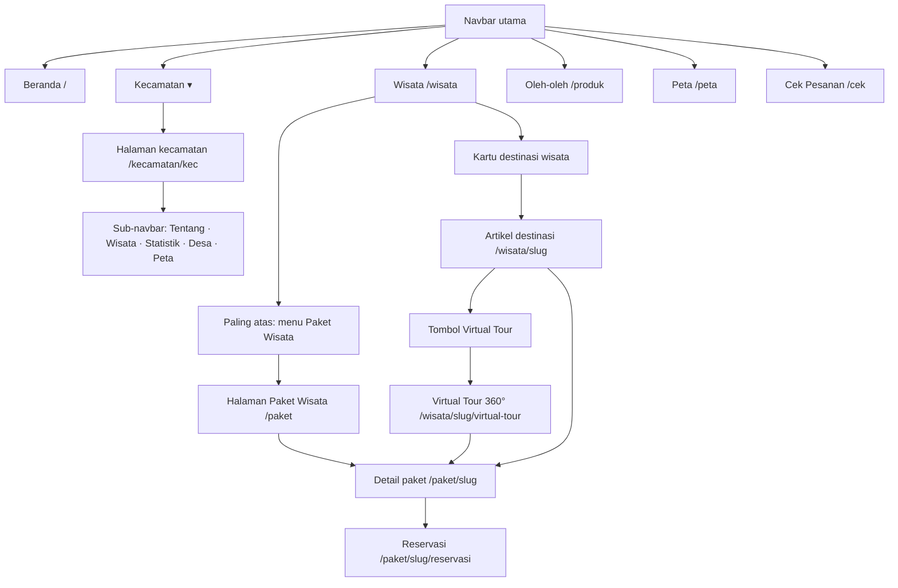
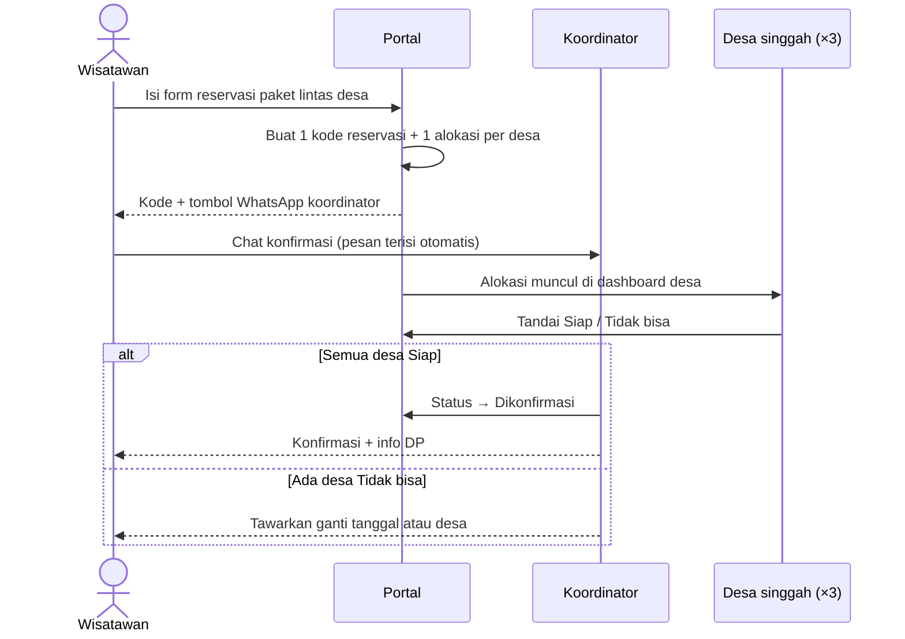

# PRD Jelajah Banggai — Portal Wisata, UMKM & Virtual Tour 360° Kabupaten Banggai Kepulauan

Nov 10, 2026 · @Dharu Bintang

> Dokumen ini menggabungkan *PRD Portal Wisata & UMKM Kabupaten Banggai Kepulauan* dan *PRD Virtual Tour 360° Jelajah Banggai* menjadi satu. Perubahan utama dari kedua PRD lama: menu **Wisata** kini berisi kartu destinasi (bukan paket), tiap destinasi punya halaman artikel, dan Virtual Tour 360° dibuka dari tombol **Virtual Tour** di artikel itu. Paket wisata punya halaman sendiri yang dibuka dari menu **Paket Wisata** di bagian paling atas halaman Wisata.

## Daftar isi

1. [Ringkasan & latar belakang](#ringkasan--latar-belakang)
2. [Tujuan, non-goals, dan metrik](#tujuan-non-goals-dan-metrik)
3. [Pengguna & peran](#pengguna--peran)
4. [Struktur halaman & navigasi](#struktur-halaman--navigasi)
5. [User flow utama](#user-flow-utama)
6. [Paket lintas desa](#paket-lintas-desa)
7. [Kebutuhan fungsional](#kebutuhan-fungsional)
8. [Model data inti](#model-data-inti)
9. [Kebutuhan non-fungsional](#kebutuhan-non-fungsional)
10. [Rekomendasi tech stack](#rekomendasi-tech-stack)
11. [SOP pemotretan 360° di lapangan](#sop-pemotretan-360-di-lapangan)
12. [Rencana rilis](#rencana-rilis)
13. [Risiko dan pertanyaan terbuka](#risiko-dan-pertanyaan-terbuka)
14. [Lampiran: data awal 12 kecamatan](#lampiran-data-awal-12-kecamatan)

## Ringkasan & latar belakang

Kita membangun portal pariwisata dan UMKM tingkat Kabupaten Banggai Kepulauan. Di satu website, wisatawan bisa:

- **mengenal destinasi wisata** lewat kartu dan artikel per tempat wisata,
- **"berjalan" di lokasi secara virtual** lewat Virtual Tour 360° ala Street View,
- **memesan paket wisata** (perahu, homestay, kuliner, pemandu), dan
- **membeli produk UMKM** (oleh-oleh), termasuk pre-order untuk diambil saat berkunjung.

Flow reservasi dan pemesanan mengikuti website Balantak Utara. Yang baru adalah lapisan wilayah kabupaten → kecamatan → desa (lengkap dengan statistik dan peta GIS per kecamatan), halaman artikel per destinasi, dan Virtual Tour 360°.

**Konteks wilayah.** Banggai Kepulauan beribu kota di Salakan dan sejak pemekaran Banggai Laut (2012) mencakup Pulau Peleng serta pulau-pulau kecil di sekitarnya. Wilayahnya terdiri dari 12 kecamatan, 141 desa, dan 3 kelurahan, dengan perkiraan penduduk 131.682 jiwa pada pertengahan 2025 ([Wikipedia, mengutip BPS](https://en.wikipedia.org/wiki/Banggai_Islands_Regency)). Perairannya adalah habitat endemik ikan capungan Banggai (Banggai cardinalfish) dan kawasan konservasi laut yang dikelola bersama Blue Alliance.

**Masalah (hipotesis, divalidasi saat survei).**

- Potensi wisata dan produk UMKM tersebar di 141 desa yang dipisahkan laut, tapi belum ada satu pintu yang menampilkan semuanya beserta cara memesan.
- Lokasi terpencil, akses perahu mahal, dan informasi visual minim, sehingga wisatawan sulit menilai lokasi sebelum berangkat.
- Promosi wisata di kawasan konservasi perlu disertai edukasi etika berkunjung.

Akibatnya wisatawan sulit merencanakan kunjungan, dan belanja ke homestay, pemandu, serta UMKM desa tidak terjadi.

**Pendekatan.**

1. Wisatawan masuk lewat **destinasi**, bukan paket: setiap tempat wisata punya kartu dan artikel yang menjelaskan apa yang ada di sana, cara menuju, dan tips.
2. Dari artikel, wisatawan bisa membuka **Virtual Tour 360°**: foto panorama equirectangular yang diambil setiap beberapa meter di jalur utama, dihubungkan dengan panah, dibuka dengan panorama drone, dan dilengkapi hotspot edukasi konservasi.
3. Artikel dan tur sama-sama mengarah ke **paket wisata** yang singgah di destinasi itu, lalu ke reservasi via WhatsApp.

**Referensi flow.** Struktur konten mengikuti website paket wisata Balantak Utara: profil → atraksi → homestay/paket → suvenir → kontak, serupa listing desa wisata di sana ([Jadesta](https://sulteng.jadesta.com/desa/lukapan_mr_conio)).

**Desa fokus KKN.** Konten lengkap pertama disiapkan untuk delapan desa: Sambulangan, Lukpanenteng, Bungin, Bakalan, Lumbi-Lumbia, Buko, Lolantang, dan Leme-leme. Tiga di antaranya adalah ibu kota kecamatan: Sambulangan (Bulagi Utara), Lolantang (Bulagi Selatan), dan Lumbi-Lumbia (Buko Selatan). Desa lainnya tampil dengan profil dasar dan dilengkapi bertahap. Virtual Tour 360° dibuat untuk **10 destinasi** yang dipilih dari hasil survei.

**Asumsi PRD ini.**

- Portal dimiliki Pemerintah Kabupaten (mis. Dinas Pariwisata), dengan admin di tingkat kecamatan dan operator di tingkat desa.
- Pembayaran versi pertama tetap via WhatsApp pengelola lalu transfer/QRIS manual, tanpa payment gateway.
- Data wilayah awal (kecamatan, desa, statistik dasar) diambil dari BPS dan data batas administrasi resmi, lalu dilengkapi hasil survei KKN.
- Virtual Tour dibangun sebagai kode di repo Next.js yang sama (bukan mockup statis). Sebelum KKN, tur memakai satu lokasi uji.
- Artikel destinasi dan konten edukasi divalidasi Dinas Pariwisata / Blue Alliance sebelum tayang.

## Tujuan, non-goals, dan metrik

Sukses berarti wisatawan bisa menemukan destinasi di kecamatan mana pun, memahaminya lewat artikel dan Virtual Tour dari HP, lalu memesan paket dari satu portal, dan portal tetap hidup setelah tim KKN pulang.

**Tujuan**

1. Wisatawan bisa menjelajah semua destinasi wisata Banggai Kepulauan lewat kartu dan artikel, dan membuka Virtual Tour 360° untuk 10 destinasi.
2. Wisatawan bisa melihat dan memesan paket wisata (perahu, homestay, kuliner, pemandu) dalam satu alur; setiap artikel dan tur mengarah ke paket yang singgah di lokasi itu.
3. Edukasi konservasi muncul tepat di titik yang relevan di dalam tur.
4. UMKM desa punya etalase online dan bisa menerima pesanan, termasuk pre-order oleh-oleh.
5. Tiap kecamatan punya halaman sendiri: tentang, wisata, statistik, daftar desa, dan peta GIS.
6. Pengelola bisa memperbarui artikel, paket, produk, harga, ketersediaan, serta foto/panah/hotspot tur sendiri tanpa menulis kode.
7. Pemda kabupaten punya satu tampilan potensi wisata dan UMKM lintas 12 kecamatan.

**Non-goals versi pertama**

- Payment gateway, escrow, atau dompet digital terintegrasi.
- Pengiriman produk ke luar daerah dengan cek ongkir otomatis.
- Aplikasi mobile native dan multi-bahasa penuh (cukup Bahasa Indonesia, Inggris menyusul).
- Marketplace terbuka untuk penjual luar desa.
- Menggantikan website resmi pemda atau sistem informasi desa (SID).
- Analisis spasial (buffer, overlay, routing); peta hanya untuk menampilkan dan menjelajah.
- Video 360°, live streaming, mode VR headset, model 3D/fotogrametri.
- Tur bawah air (kandidat fase 2).
- Upload otomatis tur ke Google Maps (manual bila disepakati).

**Metrik keberhasilan** (diukur selama periode KKN dan 3 bulan setelahnya)

| Metrik | Target | Cara ukur |
| --- | --- | --- |
| Kecamatan dengan halaman tentang, statistik, daftar desa, dan peta batas | 12 dari 12 | Kelengkapan data di dashboard |
| Desa fokus KKN dengan profil, destinasi berartikel, dan UMKM lengkap | 8 dari 8 | Kelengkapan data di dashboard |
| Destinasi dengan artikel tayang | ≥ 20 | Status artikel di dashboard |
| Destinasi dengan Virtual Tour tayang | 10 dari 10 | Status tur di dashboard |
| Scene per tur / hotspot edukasi tervalidasi per tur | ≥ 8 / ≥ 3 | Data scene dan hotspot |
| Pengunjung artikel yang klik tombol Virtual Tour | ≥ 30% | Event `tour_open` ÷ `artikel_view` (destinasi bertur) |
| Pengunjung artikel atau tur yang klik paket | ≥ 5% | Event `cta_paket_click` |
| Konversi halaman paket → klik reservasi | ≥ 5% | Analytics |
| Reservasi paket yang terkonfirmasi | ≥ 10 reservasi | Status reservasi di dashboard |
| UMKM aktif dengan ≥ 3 produk tayang / pesanan produk | ≥ 8 UMKM / ≥ 30 pesanan | Data produk dan pesanan |
| Paket lintas desa yang tayang dan pernah dipesan | ≥ 2 paket, minimal 1 lintas kecamatan | Data paket dan reservasi |
| Preview tur tampil di 3G | < 3 detik | Lighthouse dengan throttling |
| Pembaruan konten oleh admin lokal, bukan mahasiswa | ≥ 1 per bulan (konten), ≥ 1 per kuartal (tur) | Log aktivitas admin |

Target angka di atas adalah titik awal dan dikalibrasi dengan data kunjungan saat observasi.

## Pengguna & peran

Ada lima peran portal plus satu peninjau konten; tiga peran pengelola dibuat berjenjang mengikuti wilayah, sehingga tiap orang hanya mengurus data di wilayahnya.

| Peran | Siapa | Kebutuhan utama | Batasan |
| --- | --- | --- | --- |
| Wisatawan | Wisatawan dari Luwuk, Palu, Makassar; penyelam; wisatawan asing | Memilih destinasi, melihat lokasi lewat artikel dan tur 360°, tahu harga total, pesan paket dan oleh-oleh | HP, sinyal dan kuota terbatas, sering mengakses sebelum berangkat |
| Pelaku UMKM | Pengolah hasil laut dan kebun, perajin, pemilik warung | Produk terlihat, pesanan masuk lewat WhatsApp | Literasi digital rendah; tidak wajib login |
| Operator desa | Pokdarwis / BUMDes / perangkat desa | Konfirmasi reservasi; atur paket, produk, profil desa, artikel destinasi; ganti foto scene dan teks hotspot tur di desanya | Sinyal terbatas, pergantian pengurus |
| Admin kecamatan | Staf kantor camat atau koordinator Pokdarwis kecamatan | Isi halaman tentang dan statistik kecamatan, verifikasi artikel dan tur desa sebelum tayang | Waktu terbatas, bukan staf TI |
| Admin kabupaten | Dinas Pariwisata (dan tim KKN selama program) | Kelola akun, data wilayah dan peta, membuat tur (scene, panah, status), pantau seluruh kecamatan | Pemilik domain dan hosting jangka panjang |
| Mitra konservasi | Blue Alliance, Dinas terkait | Meninjau dan menyetujui isi hotspot edukasi lewat link pratinjau | Tidak perlu login |

**Prinsip desain dari persona**

- Semua aksi transaksi wisatawan berakhir di WhatsApp pengelola pemilik paket/produk.
- UMKM tidak wajib login; operator desa yang menginput produk mereka.
- Dashboard semua peran dan Virtual Tour bisa dipakai penuh dengan satu tangan di layar 360 px.
- Isi artikel dan edukasi tetap terbaca sebagai teks biasa bila panorama gagal dimuat.

## Struktur halaman & navigasi

Navbar utama berisi enam menu: **Beranda, Kecamatan ▾, Wisata, Oleh-oleh, Peta, Cek Pesanan**. Menu Kecamatan adalah pintu wilayah; menu Wisata adalah pintu destinasi.



### Halaman Wisata (`/wisata`)

Halaman Wisata berisi **kartu destinasi wisata** di seluruh Banggai Kepulauan — tempatnya, bukan paket yang sudah dipaketkan. Susunannya dari atas ke bawah:

1. **Menu Paket Wisata (paling atas).** Kartu/banner lebar dengan judul "Paket Wisata", ringkasan singkat (mis. "8 paket · mulai Rp350 rb/orang"), dan tombol menuju `/paket`. Ini satu-satunya jalan dari halaman Wisata ke daftar paket, jadi posisinya harus terlihat tanpa menggulir di HP.
2. **Judul + pencarian + filter.** Cari nama destinasi; filter kecamatan dan kategori (alam / budaya / bahari); toggle "Ada Virtual Tour 360°".
3. **Grid kartu destinasi.** Isi kartu: foto sampul, nama destinasi, kategori, desa · kecamatan, cuplikan satu kalimat, dan badge **360°** bila tur sudah tayang. Seluruh kartu bisa diklik dan membuka artikel destinasi.

Halaman Paket Wisata (`/paket`) adalah katalog paket yang sudah ada (filter kecamatan, durasi, harga) dan tetap memakai alur reservasi modul B. Menu Wisata di navbar tetap aktif saat pengguna berada di `/wisata/*` maupun `/paket/*`.

### Halaman artikel destinasi (`/wisata/[slug]`)

1. Breadcrumb: Wisata › Kecamatan › Nama destinasi.
2. Foto sampul besar, nama, kategori, desa · kecamatan.
3. **Tombol "Virtual Tour"** tepat di bawah judul, dengan thumbnail preview panorama. Di HP tombol ini juga menempel (sticky) di bawah layar saat artikel digulir. Bila tur belum tayang, tombol tidak ditampilkan (bukan tombol mati).
4. **Isi artikel**: tentang destinasi (sejarah/cerita), apa yang bisa dilakukan, tips berkunjung, etika berkunjung singkat.
5. **Info praktis** (kotak samping di desktop, blok di HP): cara menuju dari Salakan/Luwuk, titik penjemputan perahu, estimasi waktu, waktu terbaik berkunjung, tiket/retribusi, fasilitas.
6. Galeri foto dan peta lokasi mini.
7. **"Paket yang singgah di sini"**: kartu paket yang memuat destinasi ini. Bila kosong, tampilkan paket di desa yang sama; bila masih kosong, tombol tanya pengelola desa via WhatsApp.
8. Destinasi lain di kecamatan yang sama.

### Virtual Tour (`/wisata/[slug]/virtual-tour`)

Halaman layar penuh, dimuat hanya setelah tombol Virtual Tour diklik. Urutannya: layar etika berkunjung → scene drone → "Turun ke lokasi" → scene darat dengan panah, hotspot, dan CTA **"Lihat paket di lokasi ini"** yang selalu terlihat. Tombol tutup kembali ke artikel. Detail di modul V, K, dan I.

### Daftar halaman

| Halaman | URL | Isi utama |
| --- | --- | --- |
| Beranda kabupaten | `/` | Hero Banggai Kepulauan, destinasi unggulan (badge 360°), highlight paket dan UMKM, peta mini 12 kecamatan, CTA WhatsApp |
| Wisata | `/wisata` | Menu Paket Wisata di paling atas; kartu semua destinasi, cari + filter kecamatan/kategori/360° |
| Artikel destinasi | `/wisata/[slug]` | Artikel, info praktis, tombol Virtual Tour, paket yang singgah, destinasi terdekat |
| Virtual Tour | `/wisata/[slug]/virtual-tour?scene=&yaw=` | Viewer layar penuh, etika berkunjung, hotspot, CTA paket |
| Pratinjau tur (mitra) | `/wisata/[slug]/virtual-tour?preview=[token]` | Tur berstatus Ditinjau, tanpa login |
| Paket Wisata | `/paket` | Katalog semua paket, filter kecamatan/durasi/harga |
| Detail paket | `/paket/[slug]` | Itinerary, termasuk/tidak termasuk, kalkulator harga, peta rute, destinasi yang disinggahi (tautan ke artikel) |
| Reservasi & konfirmasi | `/paket/[slug]/reservasi`, `/reservasi/[kode]` | Form B3, kode, status, tombol WhatsApp, rekomendasi oleh-oleh |
| Daftar kecamatan | `/kecamatan` | Kartu 12 kecamatan (ibu kota, jumlah desa, jumlah destinasi) |
| Kecamatan · Tentang | `/kecamatan/[kec]` | Tab bawaan: sejarah, ibu kota, cara menuju, kontak kantor camat |
| Kecamatan · Wisata | `/kecamatan/[kec]/wisata` | Kartu destinasi di kecamatan itu (sama dengan `/wisata` tersaring) + paket dan homestay |
| Kecamatan · Statistik | `/kecamatan/[kec]/statistik` | Kartu angka + grafik, tahun dan sumber per angka |
| Kecamatan · Desa | `/kecamatan/[kec]/desa` | Kartu desa dan kelurahan, pencarian |
| Kecamatan · Peta | `/kecamatan/[kec]/peta` | Peta GIS batas desa + layer titik (destinasi, Tur 360°, homestay, UMKM, dermaga) |
| Halaman desa | `/kecamatan/[kec]/desa/[desa]` | Profil, destinasi, homestay, paket, UMKM, kontak operator, lokasi |
| Oleh-oleh | `/produk`, `/produk/[slug]`, `/umkm/[slug]` | Katalog per kategori dan kecamatan, profil UMKM |
| Keranjang | `/keranjang` | Item dikelompokkan per desa, ambil di desa / kirim |
| Peta (kabupaten) | `/peta` | 12 kecamatan; klik kecamatan menuju halamannya; layer destinasi dan Tur 360° |
| Cek pesanan | `/cek` | Kode + nomor WA → status reservasi atau pesanan |
| Info & bantuan | `/info` | Cara pemesanan, syarat, pembatalan, FAQ cuaca dan musim |
| Dashboard | `/admin/*` | Menu sesuai peran: kabupaten, kecamatan, atau desa (termasuk `/admin/destinasi`, `/admin/tur`, `/admin/tur/[id]`) |

Kartu destinasi, kartu paket, dan alur reservasi adalah komponen yang sama di semua level: `/wisata`, tab Wisata kecamatan, dan halaman desa hanya berbeda filternya.

## User flow utama

Ada tiga alur wisatawan yang bertemu di reservasi paket, ditambah alur oleh-oleh yang ditawarkan setelah reservasi dikonfirmasi.

```mermaid
flowchart TD
    A[Navbar → Wisata] --> B{Mau lihat apa?}
    B -->|Paket Wisata di paling atas| P1[/paket]
    B -->|Klik kartu destinasi| C[Artikel destinasi]
    M[Peta: klik titik destinasi / Tur 360°] --> C
    K[Kecamatan → tab Wisata] --> C

    C -->|Tombol Virtual Tour| E[Layar etika berkunjung]
    E --> F[Scene drone]
    F -->|Turun ke lokasi| G[Scene darat: panah, hotspot edukasi]
    G -->|Panorama gagal dimuat| FB[Fallback: galeri foto + hotspot sebagai teks]
    G -->|Lihat paket di lokasi ini| P2[Detail paket]
    FB --> P2
    C -->|Paket yang singgah di sini| P2
    P1 --> P2

    P2 --> R[Kalkulator harga + form reservasi]
    R --> KD[Kode reservasi + tombol Konfirmasi via WhatsApp]
    KD --> WA[Chat pengelola / koordinator]
    WA --> ST[Admin ubah status → wisatawan cek di /cek]
    KD --> OL[Rekomendasi oleh-oleh pre-order]
    OL --> KR[Keranjang → pesanan per desa → WhatsApp]
```

Website tidak memproses uang; ia mengumpulkan data rapi lalu menyerahkan transaksi ke WhatsApp pengelola. Contoh pesan otomatis yang dibuka tombol "Konfirmasi via WhatsApp":

```
Halo Pengelola Wisata, saya ingin konfirmasi reservasi.
Kode: RSV-2607-014
Paket: Snorkeling & Bukit 2H1M
Tanggal: 12 Juli 2027 | Peserta: 6 orang
Add-on: sewa alat snorkel (6)
Estimasi total: Rp4.200.000
Cek status: https://<domain>/reservasi/RSV-2607-014
```

Alur admin: pengelola membuka dashboard, mengubah status reservasi atau pesanan sesuai chat, dan wisatawan melihat status terbaru di halaman Cek Pesanan.

Nomor WhatsApp tujuan diambil dari penyelenggara paket (desa, kecamatan, atau kabupaten) atau desa pemilik produk, bukan satu nomor kabupaten. Keranjang yang berisi produk dari beberapa desa dipecah menjadi satu pesanan per desa.

Di dalam Virtual Tour, kartu hotspot bisa dibuka dan ditutup kapan saja, dan CTA paket selalu terlihat, tidak hanya di akhir tur.

## Paket lintas desa

Satu paket boleh singgah di beberapa desa, bahkan lintas kecamatan; wisatawan tetap melihat satu harga, satu kode reservasi, dan satu nomor WhatsApp koordinator. Pembagian tugas dan uang ke tiap desa terjadi di belakang layar dan tercatat di dashboard.

**Siapa yang boleh membuat**

| Cakupan paket | Penyelenggara (koordinator) | Persetujuan |
| --- | --- | --- |
| Satu desa | Operator desa itu | Langsung tayang |
| Beberapa desa dalam satu kecamatan | Admin kecamatan atau desa koordinator yang ditunjuk | Tiap desa singgah menyetujui perannya dan harga komponennya |
| Lintas kecamatan | Admin kabupaten (Dinas Pariwisata) atau Pokdarwis yang ditunjuk | Tiap desa singgah menyetujui; admin kecamatan terkait mendapat notifikasi |

Status paket: Draf → Menunggu persetujuan desa → Tayang. Paket tidak tayang selama ada desa singgah yang belum setuju.

**Alur reservasi**



**Harga dan pembagian pendapatan.** Harga paket = jumlah harga komponen tiap desa + transport antardesa (perahu atau mobil) + fee koordinator (persentase disepakati, mis. 5–10%). Halaman paket menampilkan total, dashboard menampilkan rincian per desa. DP diterima koordinator lalu dicatat pembagiannya per desa; versi pertama tidak mentransfer uang otomatis.

**Contoh struktur itinerary (ilustratif)**

| Hari | Desa singgah (kecamatan) | Komponen yang disiapkan desa | Perpindahan |
| --- | --- | --- | --- |
| 1 | Lumbi-Lumbia (Buko Selatan) | Penjemputan, destinasi unggulan desa, makan malam, homestay | — |
| 2 | Lolantang (Bulagi Selatan) | Pemandu lokal, destinasi unggulan desa, makan siang, homestay | Perahu/mobil dari Lumbi-Lumbia |
| 3 | Sambulangan (Bulagi Utara) | Destinasi pagi, pengambilan oleh-oleh pre-order, pengantaran pulang | Perahu/mobil dari Lolantang |

Aktivitas dan rute riil diisi dari hasil survei; urutan desa di atas hanya contoh bentuk data.

**Tampil di mana**

- Kartu paket muncul di halaman Paket Wisata, di tab Wisata setiap kecamatan yang dilewati, dan di bagian "Paket yang singgah di sini" pada artikel setiap destinasi yang disinggahi, berlabel misalnya "Lintas 3 desa · 2 kecamatan".
- Halaman paket menampilkan itinerary per hari per desa, peta rute antartitik singgah, dan tautan ke artikel destinasi yang disinggahi.
- Di halaman konfirmasi, wisatawan bisa pre-order oleh-oleh dari semua desa singgah dan mengambilnya di desa masing-masing sesuai hari kunjungan.

## Kebutuhan fungsional

MVP = semua baris **Must**; itulah yang harus jalan sebelum peluncuran di desa. Should dan Could dikerjakan bila waktu KKN tersisa. Modul A–F adalah portal; modul V, K, I, T adalah Virtual Tour.

### A. Beranda, destinasi wisata & artikel

| ID | Kebutuhan | Prioritas |
| --- | --- | --- |
| A1 | Beranda dengan hero foto/video, destinasi unggulan, CTA "Jelajahi Wisata" dan "Belanja Oleh-oleh" | Must |
| A2 | Halaman profil per desa (sejarah, budaya, fasilitas, peta lokasi) | Must |
| A3 | Halaman **Wisata** (`/wisata`) berisi kartu semua destinasi wisata di Banggai Kepulauan, bukan paket. Kartu: foto, nama, kategori, desa · kecamatan, cuplikan, badge 360° | Must |
| A4 | **Menu Paket Wisata** di bagian paling atas halaman Wisata (kartu/banner lebar) yang menuju `/paket`; terlihat tanpa menggulir di layar 360 px | Must |
| A5 | Pencarian nama + filter kecamatan, kategori (alam/budaya/bahari), dan "Ada Virtual Tour" di halaman Wisata | Must |
| A6 | Halaman **artikel destinasi** (`/wisata/[slug]`): foto sampul, isi artikel (cerita, apa yang bisa dilakukan, tips, etika singkat), info praktis (cara menuju, titik penjemputan perahu, estimasi waktu, waktu terbaik, tiket/retribusi, fasilitas), peta lokasi mini | Must |
| A7 | **Tombol "Virtual Tour"** di bawah judul artikel (dengan thumbnail preview) dan sticky di HP, membuka `/wisata/[slug]/virtual-tour`; hanya tampil bila tur berstatus Tayang | Must |
| A8 | Bagian "Paket yang singgah di sini" di artikel; bila kosong, paket di desa yang sama; bila masih kosong, tombol tanya pengelola via WhatsApp | Must |
| A9 | Galeri foto/video destinasi dan tautan media sosial desa | Should |
| A10 | "Destinasi lain di kecamatan ini" di bawah artikel | Should |
| A11 | Tombol bagikan artikel ke WhatsApp + meta Open Graph per artikel | Should |
| A12 | Artikel/berita desa sederhana | Could |

### B. Paket wisata & reservasi

| ID | Kebutuhan | Prioritas |
| --- | --- | --- |
| B1 | Halaman **Paket Wisata** (`/paket`) berisi katalog paket: nama, durasi, itinerary per hari, yang termasuk/tidak termasuk, harga per orang atau per grup, kapasitas minimum–maksimum, filter kecamatan/durasi/harga | Must |
| B2 | Kalkulator harga di halaman paket: jumlah orang + tanggal + add-on (sewa alat snorkel, pemandu, makan) → total estimasi | Must |
| B3 | Form reservasi: nama, WhatsApp, email (opsional), tanggal, jumlah peserta, catatan, persetujuan syarat & ketentuan | Must |
| B4 | Setelah submit: kode reservasi + tombol "Konfirmasi via WhatsApp" dengan pesan terisi otomatis | Must |
| B5 | Status reservasi: Menunggu konfirmasi → Dikonfirmasi → DP diterima → Selesai / Dibatalkan, bisa dicek dengan kode reservasi + nomor WA | Must |
| B6 | Halaman paket menautkan ke artikel tiap destinasi yang disinggahi | Must |
| B7 | Homestay sebagai item tersendiri atau add-on paket (harga per malam, kapasitas kamar, fasilitas) | Should |
| B8 | Blokir tanggal (cuaca buruk, perahu penuh, acara adat) di pemilih tanggal | Should |
| B9 | Upload bukti transfer/QRIS oleh wisatawan | Should |
| B10 | Ulasan dan rating setelah status Selesai | Could |

**Paket lintas desa** (detail di bagian Paket lintas desa)

| ID | Kebutuhan | Prioritas |
| --- | --- | --- |
| B11 | Paket bisa berisi beberapa desa singgah, masing-masing dengan hari ke-, urutan, komponen, destinasi yang dikunjungi, dan harga komponennya | Must |
| B12 | Penyelenggara paket bertingkat: desa, kecamatan, atau kabupaten, sesuai cakupan desa singgah | Must |
| B13 | Persetujuan desa singgah sebelum paket tayang (Draf → Menunggu persetujuan → Tayang) | Must |
| B14 | Reservasi otomatis membuat alokasi per desa; operator desa menandai Siap / Tidak bisa | Must |
| B15 | Kartu paket tampil di `/paket`, tab Wisata semua kecamatan yang dilewati, dan artikel destinasi yang disinggahi, dengan label jumlah desa/kecamatan | Must |
| B16 | Rincian harga per desa + fee koordinator di dashboard, dan rekap pembagian DP per desa | Should |
| B17 | Peta rute antartitik singgah di halaman paket | Should |
| B18 | Paket kustom: wisatawan memilih sendiri kombinasi desa dari daftar komponen | Could |

### C. Produk UMKM

| ID | Kebutuhan | Prioritas |
| --- | --- | --- |
| C1 | Katalog produk per kategori (olahan ikan, kuliner, kerajinan, hasil kebun) dengan foto, harga, stok/status ready vs pre-order | Must |
| C2 | Profil UMKM: nama usaha, pemilik, cerita singkat, desa, daftar produknya | Must |
| C3 | Keranjang sederhana lintas UMKM, lalu checkout menjadi pesanan dengan kode pesanan | Must |
| C4 | Metode penerimaan: ambil di desa saat kunjungan (terhubung ke kode reservasi) atau kirim (ongkir dikonfirmasi manual) | Must |
| C5 | Notifikasi WhatsApp ke pengelola berisi rincian pesanan, dipecah per UMKM | Must |
| C6 | Rekomendasi "Bawa pulang oleh-oleh" di halaman konfirmasi reservasi (cross-sell) | Should |
| C7 | Rekap penjualan per UMKM per bulan | Should |

### D. Dashboard pengelola

| ID | Kebutuhan | Prioritas |
| --- | --- | --- |
| D1 | Login pengelola (email + password) dengan tiga peran berjenjang: Admin kabupaten, Admin kecamatan, Operator desa; tiap peran hanya bisa mengubah data di wilayahnya | Must |
| D2 | CRUD destinasi (termasuk editor artikel sederhana dengan judul bagian, paragraf, foto), paket, homestay, produk, UMKM; upload foto dikompresi otomatis | Must |
| D3 | Status artikel destinasi: Draf → Ditinjau admin kecamatan → Tayang | Must |
| D4 | Daftar reservasi dan pesanan dengan filter status/tanggal; ubah status dengan satu ketukan | Must |
| D5 | Kalender ketersediaan (tanggal terisi, tanggal diblokir) | Should |
| D6 | Ekspor CSV reservasi/pesanan untuk laporan BUMDes | Should |
| D7 | Log aktivitas admin | Could |

### E. Wilayah: kabupaten, kecamatan, desa

| ID | Kebutuhan | Prioritas |
| --- | --- | --- |
| E1 | Navbar utama punya menu **Kecamatan** dengan dropdown 12 kecamatan, urut abjad; di HP tampil sebagai daftar yang bisa digulir | Must |
| E2 | Halaman kecamatan punya sub-navbar sendiri: Tentang, Wisata, Statistik, Desa, Peta; menempel (sticky) saat digulir | Must |
| E3 | **Tentang**: sejarah singkat, ibu kota kecamatan, cara menuju (dari Salakan/Luwuk), kontak kantor camat, foto sampul | Must |
| E4 | **Wisata**: kartu destinasi di kecamatan itu (komponen yang sama dengan A3, termasuk badge 360°), lalu paket dan homestay di kecamatan itu | Must |
| E5 | **Statistik**: kartu angka (luas, penduduk, jumlah desa/kelurahan, jumlah pulau, jumlah UMKM, jumlah destinasi) + grafik sederhana, tiap angka mencantumkan tahun dan sumber | Must |
| E6 | **Desa**: kartu desa dan kelurahan (nama, foto, jumlah destinasi/UMKM, label "Desa wisata" bila ada), dengan pencarian | Must |
| E7 | Halaman desa: profil, destinasi, homestay, paket, UMKM, kontak operator, lokasi di peta | Must |
| E8 | Breadcrumb Beranda › Kecamatan › Desa di semua halaman wilayah | Should |
| E9 | Statistik tingkat kabupaten yang merangkum 12 kecamatan, bisa dibandingkan antarkecamatan | Should |
| E10 | Statistik pariwisata dari sistem sendiri (reservasi, pesanan, wisatawan per kecamatan per bulan) | Could |

### F. Peta GIS

| ID | Kebutuhan | Prioritas |
| --- | --- | --- |
| F1 | Menu **Peta** di sub-navbar tiap kecamatan: peta interaktif dengan batas kecamatan dan batas desa | Must |
| F2 | Layer titik: destinasi wisata, homestay, UMKM, dermaga/pelabuhan, bisa dinyalakan dan dimatikan | Must |
| F3 | Klik poligon desa atau titik membuka kartu ringkas dengan tautan ke halaman detail (titik destinasi → artikel destinasi) | Must |
| F4 | Basemap jalan dan citra satelit, bisa dipilih pengguna | Should |
| F5 | Peta tingkat kabupaten (menu Peta di navbar) yang menampilkan 12 kecamatan; klik kecamatan menuju halamannya | Should |
| F6 | Admin menambah titik dengan menaruh pin di peta atau memakai lokasi HP saat survei | Should |
| F7 | Admin kabupaten bisa unggah atau ganti layer GeoJSON (mis. batas desa terbaru, zona konservasi) | Should |
| F8 | Layer tematik: zona konservasi laut, titik selam, jalur perahu | Could |
| F9 | Unduh peta kecamatan sebagai gambar/PDF untuk dicetak | Could |

### V. Virtual Tour — viewer & navigasi

| ID | Kebutuhan | Prioritas |
| --- | --- | --- |
| V1 | Viewer panorama: geser untuk melihat sekeliling, cubit untuk zoom, tombol layar penuh | Must |
| V2 | Panah di lantai menuju scene tetangga, transisi halus, tombol kembali ke scene sebelumnya | Must |
| V3 | Scene pembuka dari drone dengan tombol "Turun ke lokasi" | Must |
| V4 | Kode dan gambar viewer baru dimuat setelah tombol Virtual Tour di artikel diklik; artikel hanya memuat thumbnail preview | Must |
| V5 | Fallback galeri foto datar bila WebGL tidak tersedia atau gambar gagal dimuat | Must |
| V6 | Tombol tutup/kembali ke artikel destinasi | Must |
| V7 | Strip thumbnail scene untuk lompat langsung | Should |
| V8 | Mode giroskop: gerakkan HP untuk melihat sekeliling | Should |
| V9 | Minimap posisi scene dan arah pandang | Should |
| V10 | Link per scene dan arah pandang (`?scene=&yaw=`) untuk dibagikan | Should |
| V11 | Kompas dan putar otomatis pelan saat diam | Could |

### K. Virtual Tour — edukasi konservasi

| ID | Kebutuhan | Prioritas |
| --- | --- | --- |
| K1 | Hotspot berikon di panorama; diklik membuka kartu (judul, 2–3 kalimat, foto opsional, sumber) | Must |
| K2 | Empat tipe hotspot dengan ikon berbeda: info, aturan, spesies, zona | Must |
| K3 | Layar etika berkunjung (3–5 aturan) sebelum tur, bisa dilewati, muncul sekali per sesi | Must |
| K4 | Daftar seluruh hotspot sebagai teks di bawah viewer / di fallback | Must |
| K5 | Label "Divalidasi oleh [mitra]" di kartu | Should |
| K6 | Poligon zona (boleh dikunjungi / dilindungi) di panorama drone | Should |
| K7 | Audio narasi warga per scene | Could |

### I. Virtual Tour — integrasi portal

| ID | Kebutuhan | Prioritas |
| --- | --- | --- |
| I1 | Badge "360°" di kartu destinasi (A3, E4, E7) dan tombol Virtual Tour di artikel (A7) bila tur Tayang | Must |
| I2 | CTA "Lihat paket di lokasi ini" selalu terlihat di dalam tur, menuju paket yang memuat destinasi itu (logika sama dengan A8) | Must |
| I3 | Event analytics: `artikel_view`, `tour_open`, `scene_view`, `hotspot_open`, `cta_paket_click` (dengan sumber: artikel/tur) | Must |
| I4 | Layer "Tur 360°" di Peta kecamatan dan kabupaten; klik titik membuka artikel destinasi | Should |
| I5 | Tombol bagikan ke WhatsApp dengan link scene | Should |

### T. Virtual Tour — editor tur (dashboard)

| ID | Kebutuhan | Prioritas |
| --- | --- | --- |
| T1 | Upload panorama per scene; sistem membuat preview dan tiles otomatis | Must |
| T2 | Atur arah awal scene dengan memutar panorama lalu "Jadikan arah depan" | Must |
| T3 | Taruh panah dengan klik di panorama dan pilih scene tujuan; panah balik dibuat otomatis | Must |
| T4 | Tambah dan edit hotspot dengan klik di panorama + form | Must |
| T5 | Hak akses mengikuti peran portal (D1); tur dibuat dari halaman edit destinasi | Must |
| T6 | Status tur: Draf → Ditinjau mitra → Tayang, dengan link pratinjau tanpa login | Should |
| T7 | Lokasi scene dari GPS di file foto atau pin di peta | Should |
| T8 | Blur manual area tertentu di editor | Could |

## Model data inti

Semua konten digantungkan pada hierarki `Kecamatan` → `Desa`, sehingga halaman kecamatan, statistik, peta, dan hak akses admin bisa diturunkan dari satu kolom wilayah. Destinasi wisata memakai tabel `Atraksi` yang sudah ada di migrasi (di UI disebut "destinasi"); satu destinasi punya satu artikel dan paling banyak satu tur.

**Portal**

| Entitas | Field utama | Relasi |
| --- | --- | --- |
| `Kecamatan` | id, kode\_kemendagri (mis. 72.07.18), nama, slug, ibu\_kota, deskripsi, cara\_menuju, kontak, foto\_sampul, geom (MultiPolygon) | punya banyak Desa, Statistik, LayerPeta |
| `Desa` | id, kecamatan\_id, kode\_kemendagri, nama, slug, tipe (desa/kelurahan), deskripsi, kontak\_wa, foto, geom (MultiPolygon), titik\_pusat | punya banyak Atraksi, UMKM, Homestay; disinggahi banyak Paket |
| `Statistik` | id, kecamatan\_id, desa\_id (opsional), indikator, tahun, nilai, satuan, sumber | milik Kecamatan atau Desa |
| `LayerPeta` | id, kecamatan\_id (opsional = kabupaten), nama, tipe (poligon/garis/titik), geojson\_url, style, urutan, aktif\_default | ditampilkan di menu Peta |
| `Atraksi` (destinasi) | id, desa\_id, nama, **slug**, kategori (alam/budaya/bahari), **ringkasan**, **artikel** (Markdown/blok), **foto\_sampul**, foto\[\], **cara\_menuju**, **waktu\_terbaik**, **tiket**, **fasilitas\[\]**, lokasi (Point), **unggulan**, **status\_artikel** (draf/ditinjau/tayang) | milik Desa; dirujuk PaketSinggah; punya 0–1 Tur |
| `Paket` | id, penyelenggara\_tipe (desa/kecamatan/kabupaten), penyelenggara\_id, nama, slug, durasi\_hari, itinerary (JSON), termasuk\[\], tidak\_termasuk\[\], tipe\_harga, harga, min\_peserta, max\_peserta, aktif | banyak PaketSinggah, AddOn |
| `PaketSinggah` | id, paket\_id, desa\_id, hari\_ke, urutan, **atraksi\_id\[\]**, komponen\[\], harga\_komponen, status\_persetujuan | menghubungkan Paket, Desa, dan destinasi yang dikunjungi |
| `AddOn` | id, nama, harga, satuan (per orang/per hari/per unit) | milik Paket atau global |
| `Homestay` | id, desa\_id, nama, harga\_per\_malam, kapasitas, fasilitas\[\], lokasi (Point) | bisa dipilih di Reservasi |
| `Reservasi` | id, kode, paket\_id, nama, no\_wa, email, tanggal, jumlah\_peserta, addon\[\], total\_estimasi, status, bukti\_bayar\_url, catatan, created\_at | bisa terhubung ke banyak Pesanan |
| `AlokasiReservasi` | id, reservasi\_id, paket\_singgah\_id, desa\_id, tanggal, jumlah\_peserta, nominal\_bagian, status (menunggu/siap/tidak\_bisa), catatan | satu per desa singgah per reservasi |
| `UMKM` | id, desa\_id, nama\_usaha, nama\_pemilik, no\_wa, cerita, foto, lokasi (Point) | punya banyak Produk |
| `Produk` | id, umkm\_id, nama, kategori, harga, satuan, stok, tipe (ready/pre-order), lead\_time\_hari, foto\[\], aktif | — |
| `Pesanan` | id, kode, desa\_id, nama, no\_wa, item\[\], metode (ambil/kirim), reservasi\_id (opsional), ongkir, total, status, created\_at | satu pesanan per desa |
| `Pengguna` | id, nama, email, password\_hash, peran, kecamatan\_id, desa\_id | lingkup akses mengikuti wilayah |

Field **tebal** di `Atraksi` dan `PaketSinggah` adalah tambahan dari PRD ini dan perlu migrasi baru.

**Virtual Tour**

| Entitas | Field utama | Relasi |
| --- | --- | --- |
| `Tur` | id, atraksi\_id (unik), scene\_awal\_id, status (draf/ditinjau/tayang), validator\_mitra, divalidasi\_pada, preview\_token | milik satu Atraksi; punya banyak Scene. URL diturunkan dari slug atraksi |
| `Scene` | id, tur\_id, nama, urutan, tipe (darat/udara), tiles\_url, preview\_url, yaw\_awal, koreksi\_utara, lokasi (Point), diambil\_pada | punya banyak TautanScene dan Hotspot |
| `TautanScene` | id, dari\_scene\_id, ke\_scene\_id, yaw, pitch | satu panah; pasangan balik dibuat otomatis |
| `Hotspot` | id, scene\_id, tipe (info/aturan/spesies/zona), yaw, pitch, judul, isi, foto\_url, sumber, poligon (opsional) | milik Scene |
| `AturanBerkunjung` | id, urutan, teks, ikon, tur\_id (kosong = berlaku untuk semua tur) | tampil di layar etika (K3) |

Harga di item `Pesanan` dan `Reservasi` disalin saat transaksi, supaya perubahan harga kemudian tidak mengubah tagihan lama. Kolom `geom` dan `lokasi` disimpan di PostGIS dan dikirim ke peta sebagai GeoJSON yang sudah disederhanakan. Titik scene pertama tiap tur diekspor sebagai `LayerPeta` bertipe titik bernama "Tur 360°".

## Kebutuhan non-fungsional

Kendala terbesar bukan fitur, tapi sinyal lemah di lokasi, pengelola yang tidak teknis, dan foto 360° sebagai aset terberat.

**Umum**

- **Ringan di jaringan lambat:** halaman publik < 1 MB pada muatan pertama, gambar WebP dengan lazy-load, LCP < 3 detik di 3G. Halaman publik (termasuk `/wisata` dan artikel) dirender statis/ISR.
- **Mobile-first:** semua alur wisatawan, Virtual Tour, dan dashboard bisa diselesaikan di layar 360 px dengan satu tangan; kontrol ≥ 44 px.
- **Tahan sinyal putus di dashboard:** form (termasuk editor artikel) simpan draf lokal; upload foto bisa diulang tanpa mengisi ulang form.
- **Biaya operasional rendah:** total di bawah Rp300 ribu per tahun (praktis hanya domain), memakai free tier.
- **Keamanan dasar:** HTTPS, password di-hash, rate limit dan captcha ringan di form reservasi/pesanan, nomor WA pemesan tidak tampil publik.
- **Privasi:** data pemesan hanya untuk proses transaksi; kebijakan privasi singkat; data reservasi > 12 bulan bisa dihapus.
- **Keberlanjutan:** akun admin atas nama lembaga, domain dan hosting atas nama pemda/BUMDes, panduan pengelola PDF + video, minimal 2 operator desa dilatih.
- **SEO lokal:** meta tag dan Open Graph per artikel destinasi, paket, dan produk; sitemap.xml; profil Google Business untuk desa wisata. Artikel destinasi adalah halaman yang paling diharapkan masuk mesin pencari.

**Peta**

- GeoJSON batas desa per kecamatan disederhanakan hingga < 300 KB; peta baru dimuat saat tab Peta dibuka.
- Halaman Peta menampilkan gambar statis peta kecamatan sebagai cadangan bila tile basemap gagal dimuat.
- Kode wilayah mengikuti kode Kemendagri; nama dan batas desa satu sumber untuk halaman, statistik, dan peta.
- Setiap angka statistik menampilkan tahun dan sumber; angka lebih dari 2 tahun ditandai "perlu diperbarui".

**Virtual Tour** — tidak ada yang dimuat sebelum diminta, dan yang dimuat pertama selalu versi kecil.

- Thumbnail preview di artikel ≤ 150 KB; scene pertama tampil dari versi resolusi rendah (lebar ±2048 px, ≤ 400 KB), lalu tiles resolusi tinggi dimuat sesuai arah pandang.
- Kode viewer dimuat lewat dynamic import hanya di halaman Virtual Tour; artikel tidak bertambah berat selain thumbnail.
- Pramuat scene tetangga hanya versi resolusi rendah, dan dimatikan bila browser melaporkan mode hemat data.
- Izin giroskop di iOS diminta lewat tombol, bukan otomatis.
- Aksesibel: navigasi dengan tombol panah keyboard, deskripsi teks per scene, daftar hotspot sebagai teks (K4).
- Wajah dan plat kendaraan diblur sebelum upload; tidak memotret rumah warga atau tempat sakral tanpa izin; ada jalur permintaan hapus foto.
- Data tersimpan dalam format terbuka (JPG equirectangular + JSON scene), bisa diekspor tanpa layanan berbayar.
- Perkiraan kasar 10 tur × ±20 scene × ±8 MB tiles ≈ 1,6 GB, sehingga tiles disimpan di object storage terpisah dari Supabase Storage.

## Rekomendasi tech stack

Pilih stack yang bisa di-hosting gratis dan dirawat tanpa server sendiri; tim KKN tidak akan ada untuk mengurus VPS. Virtual Tour hidup di repo Next.js yang sama.

| Lapisan | Rekomendasi | Alasan | Alternatif |
| --- | --- | --- | --- |
| Frontend + backend | Next.js (App Router) + TypeScript | Halaman statis/ISR, rute dinamis `/wisata/[slug]` dan `/kecamatan/[kec]`, API route untuk form | Astro + API terpisah |
| Database & auth | Supabase (Postgres + PostGIS + Auth + Storage) | PostGIS untuk wilayah dan titik; RLS untuk membatasi admin per kecamatan/desa | Neon + PostGIS + Auth.js |
| Konten artikel | Kolom Markdown/blok di tabel `Atraksi`, dirender server-side | Editor sederhana di dashboard, tanpa CMS berbayar | Headless CMS (fase 2) |
| Peta | MapLibre GL JS (atau Leaflet) + basemap OpenStreetMap | Gratis, ringan, layer GeoJSON bisa dinyalakan/dimatikan | Mapbox |
| Viewer 360° | [Photo Sphere Viewer](https://photo-sphere-viewer.js.org/) v5 + [VirtualTourPlugin](https://photo-sphere-viewer.js.org/plugins/virtual-tour) | Menautkan banyak panorama; panah manual atau dari GPS; TypeScript | Pannellum, Marzipano |
| Plugin viewer | Markers (hotspot), Gallery, Gyroscope, Map/Plan, Compass, Autorotate | Satu keluarga PSV, terintegrasi dengan plugin tur | — |
| Integrasi viewer | Komponen client dengan `dynamic(..., { ssr: false })` | Butuh WebGL; tidak ikut bundle halaman lain | — |
| Gambar 360° resolusi tinggi | Adapter tiles equirectangular PSV + script Node (sharp) yang memotong panorama menjadi tiles dan preview | Hanya potongan yang dilihat yang diunduh | Cubemap |
| Penyimpanan tiles | [Cloudflare R2](https://developers.cloudflare.com/r2/pricing/) | Free tier 10 GB dan egress gratis | Supabase Storage |
| Data batas wilayah | Batas administrasi BIG (Ina-Geoportal), disederhanakan dengan mapshaper | Sumber resmi | Peta desa partisipatif |
| Data statistik | BPS Kabupaten Banggai Kepulauan (Dalam Angka, Kecamatan Dalam Angka) | Sumber resmi per kecamatan | Prodeskel |
| Grafik | Recharts atau Chart.js | Grafik statistik sederhana | — |
| Foto biasa | Supabase Storage / Cloudinary free | Kompresi dan transformasi otomatis | — |
| Hosting | Vercel (Hobby), lalu akun atas nama pemda | Deploy dari GitHub, HTTPS otomatis | Netlify, Cloudflare Pages |
| Notifikasi | Tautan `wa.me` dengan pesan terisi otomatis | Tanpa biaya API | WhatsApp Cloud API (fase 2) |
| Analytics | Umami atau GA4 | Konversi artikel → tur → paket dalam satu tempat | Plausible |
| CI/CD | GitHub Actions: lint, typecheck, build preview per PR | Mencegah rilis rusak saat tim berganti | — |

Catatan: perhatikan batas free tier Supabase (project bisa di-pause jika tidak aktif). Siapkan cron ringan atau upgrade bila desa mulai aktif menerima transaksi.

**Struktur kode yang disarankan**

```
src/app/(site)/wisata/page.tsx                    # menu Paket Wisata + grid kartu destinasi
src/app/(site)/wisata/[slug]/page.tsx             # artikel destinasi + tombol Virtual Tour
src/app/wisata/[slug]/virtual-tour/page.tsx       # viewer layar penuh (di luar layout navbar)
src/app/(site)/paket/...                          # katalog dan detail paket (sudah ada)
src/app/admin/destinasi/, src/app/admin/tur/      # dashboard artikel dan editor tur
src/components/DestinasiCard.tsx                  # dipakai di /wisata, tab kecamatan, halaman desa
src/features/tour/                                # viewer, kartu hotspot, layar etika, fallback
scripts/make-tiles.ts                             # potong panorama jadi tiles + preview
src/data/tours/demo.json                          # data tur statis sebelum tabel Supabase siap
```

## SOP pemotretan 360° di lapangan

Kualitas tur ditentukan saat memotret: arah kamera yang konsisten adalah satu-satunya cara agar panah maju-mundur tidak melenceng. Foto untuk artikel destinasi diambil pada kunjungan yang sama.

1. Survei jalur dan tandai titik foto di peta: tiap 3–5 m di jalur sempit, tiap 8–15 m di area terbuka.
2. Pasang kamera di monopod setinggi mata (±1,6 m), tegak lurus; operator menjauh atau memakai timer.
3. Hadapkan lensa depan kamera ke arah "maju" di jalur pada setiap titik; catat bila terpaksa berbeda.
4. Nyalakan GPS (lewat HP yang terhubung ke kamera) atau catat koordinat manual.
5. Potret pagi atau sore, hindari matahari tepat di atas kepala; aktifkan mode HDR.
6. Ambil dua foto per titik sebagai cadangan.
7. Beri nama file `[slug-destinasi]-[urutan]-[tanggal].jpg`.
8. Drone: satu panorama sferis per lokasi, hanya setelah cek cuaca, angin, izin pengelola, dan aturan terbang.
9. Minta orang menyingkir dari frame; tempat sakral hanya dipotret dengan izin adat.
10. Ambil juga 5–10 foto datar untuk sampul dan galeri artikel, serta catat bahan artikel (cerita warga, harga tiket, fasilitas, waktu terbaik).
11. Cadangkan foto setiap hari ke dua media berbeda.

## Rencana rilis

MVP dibangun sebelum berangkat, sehingga waktu di lokasi dipakai untuk konten, pemotretan, uji coba, dan pelatihan, bukan coding.

| Fase | Kapan | Isi | Gerbang keluar |
| --- | --- | --- | --- |
| 1. Fondasi portal | Pra-KKN | Navbar, wilayah (E), halaman Wisata + artikel destinasi (A3–A8), Paket Wisata + reservasi (B), oleh-oleh (C), dashboard dasar (D) dengan data contoh | **Gerbang A**: semua Must modul A–D jalan di HP 360 px dan lolos uji 3G |
| 2. Prototipe Virtual Tour | Pra-KKN, paralel setelah artikel jadi | Viewer + etika + hotspot + fallback dengan 1 lokasi uji (15–20 panorama, 1 scene drone, 5 hotspot); tombol Virtual Tour di artikel; script tiles | **Gerbang B**: tur uji dibuka dari artikel, preview < 3 detik di 3G, CTA paket berfungsi |
| 3. Editor & peta | Pra-KKN bila waktu cukup | Editor tur (T1–T4), editor artikel, peta GIS (F1–F3) | Admin non-teknis bisa membuat 1 artikel dan 1 scene tanpa bantuan |
| 4. Konten lapangan | Selama KKN | Survei, pemotretan 10 destinasi, penulisan artikel, input paket dan UMKM 8 desa fokus, validasi mitra | **Gerbang C**: 10 tur dan ≥ 20 artikel berstatus Tayang |
| 5. Peluncuran & pelatihan | Akhir KKN | Peluncuran di desa, pelatihan ≥ 2 operator per desa, serah terima ke Dinas Pariwisata | Panduan PDF + video diserahkan, akun atas nama lembaga |
| 6. Pasca-KKN | 3 bulan setelahnya | Pemantauan metrik, perbaikan, fitur Should yang tertunda | Metrik ditinjau bersama pemda |

Tiap gerbang harus lolos sebelum fase berikutnya. Bila Gerbang A belum lolos saat berangkat, fitur Should ditunda dan fokus ke halaman Wisata, artikel, dan reservasi. Bila Gerbang B belum lolos, tur dibuat tim KKN lewat JSON dan editor menyusul.

## Risiko dan pertanyaan terbuka

**Risiko**

| Risiko | Dampak | Mitigasi |
| --- | --- | --- |
| Konten 12 kecamatan tidak terisi; hanya desa KKN yang lengkap | Portal terlihat kosong di luar lokasi KKN | Isi minimum otomatis dari BPS + batas wilayah; kartu destinasi minimal (foto + ringkasan) boleh tayang sebelum artikel lengkap |
| Artikel ditulis asal-asalan atau tidak akurat | Wisatawan salah ekspektasi, kepercayaan turun | Template artikel tetap (cerita, aktivitas, tips, info praktis), status Ditinjau oleh admin kecamatan |
| Pengelola tidak merespons WhatsApp dengan cepat | Wisatawan batal | Dua nomor WA per desa, template balasan cepat, SLA ≤ 24 jam di halaman Info |
| Kepemilikan portal tidak jelas antara KKN dan pemda | Domain/hosting kedaluwarsa | MoU atau surat serah terima dengan Dinas Pariwisata; domain dan akun atas nama pemda |
| Kamera 360° atau drone tidak tersedia | Tur tidak bisa dibuat | Sewa, pinjam lab, atau sponsor alat; cadangan: mode panorama HP untuk lokasi prioritas; artikel tetap tayang tanpa tombol Virtual Tour |
| Arah kamera tidak konsisten | Panah melenceng | SOP poin 3 + fitur atur arah di editor (T2) |
| File 360° terlalu berat | Portal lambat | Tiles, preview kecil, dynamic import, uji 3G di setiap gerbang |
| Spot ekosistem rentan terekspos | Kerumunan dan kerusakan | Validasi mitra; spot tertentu sengaja tidak dibuat artikel/tur |
| Data batas desa tidak tersedia atau tidak sesuai lapangan | Peta menyesatkan | Pakai batas resmi BIG, tandai "indikatif", koreksi lewat admin kecamatan |
| Statistik usang | Angka dipertanyakan | Tampilkan tahun dan sumber, label "perlu diperbarui" |
| Harga perahu dan paket berubah musiman | Estimasi harga salah | Label "estimasi", harga final dikonfirmasi pengelola |
| Cuaca/gelombang membatalkan perjalanan atau pemotretan | Refund, komplain, < 10 lokasi terpotret | Kebijakan pembatalan dan reschedule, blokir tanggal, jadwal cadangan pemotretan, prioritaskan 5 lokasi utama |
| Keberatan warga soal privasi foto | Tur atau artikel diturunkan | Izin tertulis, blur, jalur permintaan hapus |
| Konflik pembagian pendapatan antar pihak | Program ditolak warga | Sepakati skema bagi hasil di musyawarah desa sebelum peluncuran |

**Pertanyaan terbuka**

- [ ] Apakah Dinas Pariwisata Banggai Kepulauan bersedia menjadi pemilik portal, atau portal dikelola dulu oleh desa/BUMDes?
- [ ] Bagaimana portal ditautkan dengan website resmi pemda (banggaikep.go.id) dan website desa yang sudah ada?
- [ ] Lima desa fokus KKN lainnya (Lukpanenteng, Bungin, Bakalan, Buko, Leme-leme) masuk kecamatan apa?
- [ ] Apa saja 10 destinasi final untuk Virtual Tour, dan di desa serta kecamatan mana?
- [ ] Siapa yang menulis artikel destinasi: tim KKN, operator desa, atau Dinas? Siapa yang meninjau?
- [ ] Apakah batas desa resmi tersedia untuk seluruh 141 desa?
- [ ] Kamera 360° dan drone apa yang tersedia: beli, sewa, atau pinjam?
- [ ] Apakah Blue Alliance bersedia menjadi validator dan penyedia materi edukasi?
- [ ] Berapa besar DP dan bagaimana kebijakan refund jika batal karena cuaca?
- [ ] Apakah ada fee pengelola dari tiap reservasi atau pesanan UMKM?
- [ ] Untuk paket lintas desa: siapa koordinator default, berapa fee koordinator, dan bagaimana DP diteruskan ke tiap desa?
- [ ] Perlukah versi Bahasa Inggris (artikel dan kartu edukasi) sejak awal untuk wisatawan asing dan penyelam?
- [ ] Apakah tur juga diunggah ke Google Maps, dan akun siapa yang dipakai? Apakah tur bawah air masuk fase 2?

## Lampiran: data awal 12 kecamatan

Data ini menjadi isi awal dropdown Kecamatan dan tabel `Kecamatan`/`Statistik`; angka penduduk adalah estimasi pertengahan 2025.

| Kecamatan | Kode | Ibu kota | Luas (km²) | Penduduk 2025 | Desa/kel. | Pulau |
| --- | --- | --- | --- | --- | --- | --- |
| Buko | 72.07.07 | Tabata | 184,84 | 10.569 | 13 | 21 |
| Buko Selatan | 72.07.18 | Lumbi-Lumbia | 187,32 | 9.301 | 11 | — |
| Bulagi | 72.07.06 | Bulagi Satu | 275,66 | 9.921 | 16 | 2 |
| Bulagi Selatan | 72.07.09 | Lolantang | 319,00 | 10.813 | 20 | 8 |
| Bulagi Utara | 72.07.17 | Sambulangan | 318,00 | 10.260 | 12 | — |
| Liang | 72.07.05 | Liang | 176,19 | 10.602 | 16 | 65 |
| Peling Tengah | 72.07.16 | Patukuki | 140,00 | 11.042 | 11 | — |
| Tinangkung | 72.07.04 | Salakan | 312,60 | 19.529 | 11 | 52 |
| Tinangkung Selatan | 72.07.11 | Mansamat | 187,89 | 8.834 | 9 | — |
| Tinangkung Utara | 72.07.19 | Batulombo | 136,65 | 9.620 | 6 | — |
| Totikum | 72.07.03 | Sambiut | 155,45 | 11.570 | 11 | 4 |
| Totikum Selatan | 72.07.15 | Kalumbatan | 95,19 | 9.621 | 8 | — |

Sumber: [Banggai Islands Regency, Wikipedia](https://en.wikipedia.org/wiki/Banggai_Islands_Regency), mengutip BPS, Kabupaten Banggai Kepulauan Dalam Angka 2026. Verifikasi ulang ke [BPS Banggai Kepulauan](https://bangkepkab.bps.go.id) sebelum diinput.

## Sumber

- [Banggai Islands Regency — Wikipedia](https://en.wikipedia.org/wiki/Banggai_Islands_Regency)
- [Desa Wisata Lukapan Mr. Conio — Jadesta](https://sulteng.jadesta.com/desa/lukapan_mr_conio) (referensi flow Balantak Utara)
- [Photo Sphere Viewer: VirtualTourPlugin](https://photo-sphere-viewer.js.org/plugins/virtual-tour)
- [Cloudflare R2 pricing](https://developers.cloudflare.com/r2/pricing/)
- [Blue Alliance di Banggai (For the Ocean)](https://for-the-ocean.org/?p=1553)
